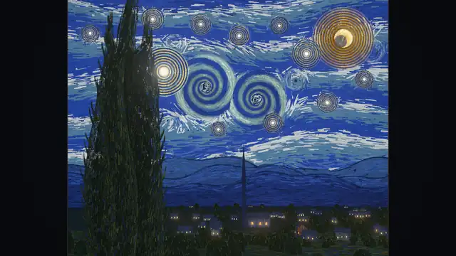
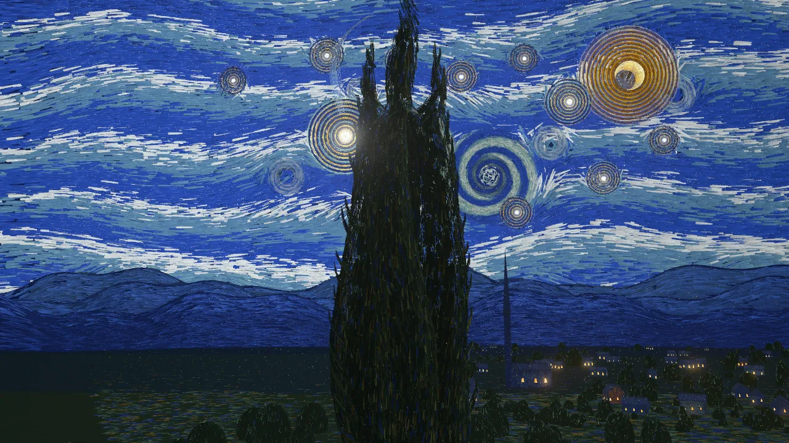
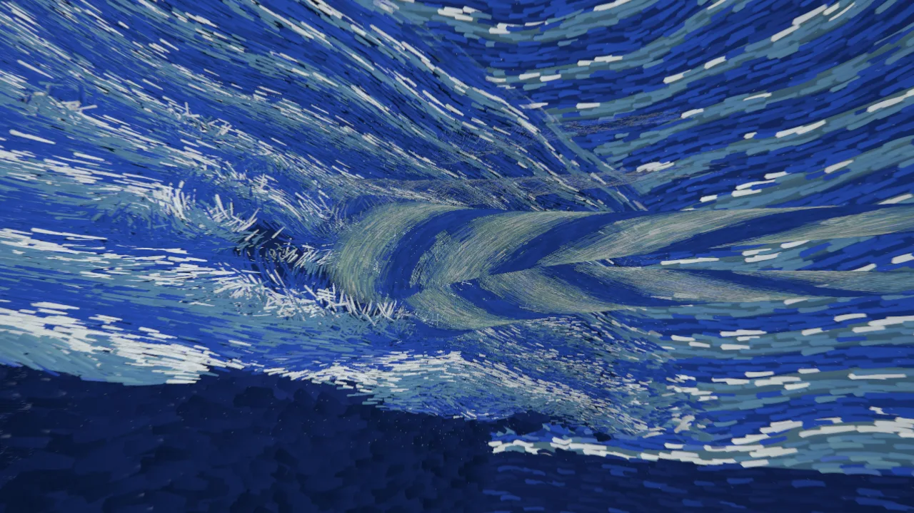

# The Starry Night, from One Viewpoint · 星夜，只在一個點成立



About 181,000 brushstrokes are scattered through 3D space, up to 250 km deep. From exactly one point, the painter's eye *E*, they line up into Van Gogh's *The Starry Night*. Step aside and the painting comes apart.

約 18 萬筆筆觸散布在最深 250 公里的 3D 空間裡。只有站在畫家眼睛的那一點 *E*，它們才拼回梵谷的《星夜》；一離開那個點，畫就散開成立體的世界。

**Open it:** <https://taipei49314.github.io/starry-night-3d/> · single-file version: <https://taipei49314.github.io/starry-night-3d/single.html>

## What you are looking at

| At the eye *E* | Stepping aside | Inside the sky |
|---|---|---|
|  |  |  |

- Each stroke is drawn in canvas coordinates and given one free value, its distance from *E*. Its size in the world grows with that distance, so seen from *E* it covers the same pixels at any depth.
- Paint order becomes depth: the last touches (the cypress, the village) are nearest, and the underpainting is 250 km away. Each flat motif is the end-on view of a 3D form; the swirl is a pair of funnels pointing at the eye.
- Everything is generated in code. No textures, models or audio files are used.
- The opening is a 96-second, 10-shot camera loop: the canvas paints itself in, the frame slides away, the camera climbs the cypress, passes through Venus, falls into one of the two 50 km swirl funnels and flies back to *E*.
- Drag to look, use W A S D to fly, and press Space to return to *E*. The full controls are below.

The images above were rendered from this repository's code in headless Chrome on an NVIDIA laptop GPU, with the UI hidden.

## Also in this repository

The same engine renders 29 other Van Gogh paintings. They are reachable from the top bar or by URL:

- `?mode=witness`: a five-chapter journey through his life (Nuenen, Paris, Arles, Saint-Rémy, Auvers). Its letter cards show a short summary written for this piece, not a quotation, with a link to the letter in the Van Gogh Museum / Huygens ING edition at [vangoghletters.org](https://vangoghletters.org/). The epilogue card, from Jo van Gogh-Bonger's diary, has no online link. Shortcut `J`; hold `Shift` to linger.
- `?mode=odyssey`: all 30 paintings as one continuous 900-second flight, returning to each painting's eye before moving on.
- `?mode=atlas`: a map of the 30 worlds and the paths between them.

[docs/SPEC.md](docs/SPEC.md) describes the geometry, the camera choreography and all modes in detail.

## Run & Verify

```bash
npm install
npm run dev                 # http://127.0.0.1:5199
npm run build               # typecheck + production bundle in dist/
npm run build:single        # one self-contained dist-single/index.html
```

`scripts/verify-worlds.mjs` runs in CI on a GitHub-hosted runner after the build (it needs `dist/` and Playwright's Chromium). It fails the job on page or console errors, a world whose generator threw, a failed self-test or paint-order check, a camera not registered at E, an unclean Odyssey hold (Act I and *The Starry Night* act, each checked to show the right painting), or a blank frame among the 30 worlds at E and the holds (after one retry). Off-E frames and a high-tier set are recorded for people to look at, with their size and renderer state, but never fail the job. Every run uploads the screenshots as the `punctum-30-worlds-screenshots` artifact; `verification-report.json` is written on passing runs.

Status: CI runs these checks on every push to main and on every pull request, on a software renderer. Human visual acceptance and the hardware performance targets in SPEC §9.3 have not been established.

## Controls

Any input hands control to you; after 12 s idle the camera rejoins the current act's timeline.

| Input | Action |
|---|---|
| drag | look |
| W A S D, arrow keys, Q / E | fly (speed scales with distance from E); the wheel sets the speed |
| Touch Flight Pad (`▲ 前進` / `▼ 後退` / `◎ 歸位`) | on-screen touch flight & return-to-$E$ controls on mobile/tablet |
| Alt-drag or right-drag | stir the sky |
| Shift + wheel | depth warp: at E the image does not change; step aside and the world refolds |
| Space | fly back to the painter's eye $E$ in the current act and re-register the painting |
| `P` or `⏸ 暫停` button | pause / resume the camera timeline and its automatic flights (return-to-eye, idle rejoin); you can still fly yourself, and the brushstrokes keep their gentle motion |
| `Enter` or click 3D Portal Beacon | leap through the active painting's 3D Spatial Portal when the beacon is visible |
| `[` / `]` or `PageUp` / `PageDown` | switch to previous / next painting in the active sequence via 6-Motif 3D Brushstroke Cross-Dissolve |
| `J` | toggle the 5-Chapter Witness Journey (`?mode=witness`) vs. the single-painting loop of the current painting; from the single *Starry Night* the journey starts at Chapter I |
| Shift (hold) | in the Witness Journey, linger: the camera slows during contemplation windows |
| `O` | toggle 5-Chapter 30-Act Odyssey (`∞ 五章三十幕`) vs. single-painting loop (`◎ 單幅沉浸循環`) |
| `U` | toggle the interactive **Van Gogh World Graph Atlas (`🌌 宇宙星圖`)** |
| `V` | toggle 30-World Procedural Soundscape (`♪ 聲景：開 / 靜音`) |
| Scrubber Timeline (bottom) | drag or click anywhere along the active Odyssey / Theme Path / Single-World shot timeline |
| 1-9, 0 | jump to shot 1-10 within the active painting |
| C / R | resume the cinematic / restart the current painting act |
| G | storm |
| M | calm mode (less roll, FOV, scatter, and particle drift; the default with `prefers-reduced-motion`) |
| H | HUD |

URL flags: `?painting=potato|weaver|tower|skull|shoes|galette|paris|seine|plum|tanguy|selfportrait|yellowhouse|sunflowers|harvest|sower|cafe|nightcafe|rhone|bedroom|starry|irises|olive|wheat|roadcypress|almond|cottages|church|gachet|daubigny|crows`, `?mode=witness|odyssey|theme|atlas`, `?path=odyssey|nights|roads|dwellings|flora|gaze|woven|single`, `?odyssey=1|0`, `?t=<sec>`, `?free`, `?tier=high|medium|low`, `?calm`, `?hud`, `?overlay`, `?seed=`, `?freeze`, `?boot=<sec>&freeze`.

## License

MIT, see [LICENSE](LICENSE). The page bundles [three.js](https://github.com/mrdoob/three.js) r186 (MIT) and David Hoskins's GLSL "Hash without Sine" functions (MIT); their notices ship as `THIRD_PARTY_NOTICES.md` next to the built page and in a comment at the top of `index.html` and `single.html`.
